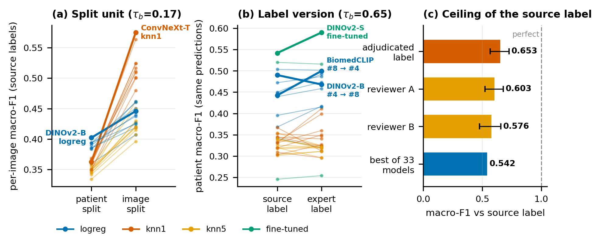

# OrthoBench: An Expert-Audited Multimodal Benchmark for Orthodontic Diagnosis

OrthoBench is an expert-audited multimodal benchmark for orthodontic diagnosis. It links intraoral photo series, panoramic radiographs (OPG), and cephalograms
of the same orthodontic patients to a patient-level Angle class, and adds an expert
audit in which two reviewers and a senior adjudicator re-label 240 patients. The code
here measures how two evaluation choices change a model leaderboard: the split unit
(image vs patient) and the reference-label version (source vs expert).




**In the primary audit, 75 of 221 classifiable patients (33.9%) receive a different
expert label.** Re-scoring identical predictions against the expert label re-orders the model leaderboard (Kendall tau-b 0.65), and an image-level split fills the top ranks with memorising 1-NN heads. This measures disagreement with the source label, not proven clinical error.

## News

- **November 2026 (CVPR 2027 revision):** encoder zoo (11 frozen encoders x 3 heads,
  plus fine-tuned backbones), split-unit and label-version leaderboard statistics under a
  frozen analysis plan, label ceiling and human reference, label-error detection,
  confident-learning pruning, late fusion.
- **September 2026:** completed audit of 240 double-reviewed patients and an audit-held-out
  reference evaluation with perceptual-hash quarantine.
- **August 2026:** historical source-label experiments (leakage, fine-tuning, fusion, OCR
  screening and redaction).

## Quickstart

The synthetic smoke path needs no clinical data, model download, or GPU:

```bash
python -m venv .venv
source .venv/bin/activate
pip install numpy pandas scikit-learn Pillow matplotlib certifi scipy openpyxl
python run_experiment.py smoke
python -m unittest discover -s tests -v
```

Feature extraction and fine-tuning need `requirements.txt` (PyTorch, torchvision,
transformers, open_clip). Set `PYTORCH_ENABLE_MPS_FALLBACK=1` on Apple MPS.

## Results

Same predictions on 189 audit-held-out patients, patient macro-F1 (linear and fine-tuned entries). `results/zoo_reference.json` has all entries and intervals.

| Entry | Source label | Expert label | Rank (source / expert) |
|--|--:|--:|--:|
| DINOv2-S / fine-tuned | 0.542 | 0.590 | 1 / 1 |
| ConvNeXt-T / fine-tuned | 0.520 | 0.516 | 2 / 2 |
| ResNet-18 / logreg | 0.504 | 0.502 | 3 / 3 |
| BiomedCLIP / logreg | 0.442 | 0.500 | 8 / 4 |
| ConvNeXt-T / logreg | 0.450 | 0.492 | 6 / 5 |
| DINOv2-S / logreg | 0.472 | 0.487 | 5 / 6 |
| SigLIP-2 / logreg | 0.448 | 0.473 | 7 / 7 |
| DINOv2-B / logreg | 0.490 | 0.468 | 4 / 8 |
| DINOv2-L / logreg | 0.439 | 0.458 | 9 / 9 |
| ConvNeXt-L / logreg | 0.368 | 0.417 | 11 / 10 |
| CLIP-B/16 / logreg | 0.396 | 0.415 | 10 / 11 |
| ResNet-50 / logreg | 0.342 | 0.320 | 17 / 25 |
| ResNet-50 / fine-tuned | 0.246 | 0.254 | 33 / 33 |

Kendall tau-b between the two leaderboards: 0.65 (95% CI 0.46 to 0.77); 13 of 528 entry pairs re-order significantly.
Split unit (`results/split_zoo.json`): Kendall tau-b 0.17 between image- and patient-split leaderboards, and mean inflation 0.160 for 1-NN vs 0.048 for the linear head.
Label ceiling (`results/label_analysis.json`): the adjudicated label scores 0.653 macro-F1 against the source label, and the two reviewers score 0.603 and 0.576.

## Reproduce the CVPR 2027 experiments

With approved access to the restricted data (`DR`) and the audit workbook (`WB`):

```bash
for M in opg cephalogram intraoral; do
  python scripts/extract_zoo.py --data-root "$DR" --modality $M \
    --backbones resnet18,resnet50,convnext_tiny,convnext_large,dinov2,dinov2_base,dinov2_large,rad_dino,siglip2,clip_b16,biomedclip
done
python scripts/run_cvpr27.py split                      # results/split_zoo.json
python scripts/run_cvpr27.py predict --workbook "$WB"   # per-patient predictions (gitignored)
for A in dinov2 resnet50 convnext_tiny; do
  python scripts/finetune_reference.py --workbook "$WB" --arch $A --seeds 0 1 2
done
python scripts/run_cvpr27.py analyze --workbook "$WB"   # zoo_reference, label_analysis, fusion_late
python scripts/make_figures_cvpr27.py
```

The frozen analysis plan is `cvpr27_plan.json`. Restricted images are read in place and
never copied. Feature caches and per-patient predictions stay in the ignored `data/`
directory. Results JSONs are aggregate only. Earlier experiments are reproduced with
`run_experiment.py` subcommands (see `--help`) and `scripts/analyze_reference.py`.

## Data access

Clinical images and case-level records are restricted. The study received
institutional ethics approval and data-use permission. Identifying details are
withheld for double-blind review. Access is controlled through a data-use agreement
with the data custodian. The code license does not apply to clinical data. OCR screening
and border redaction are triage aids, not pixel-privacy certification.

## Repository structure

- `orthobench/`: manifests, splits, encoders (`features.py`), probes, metrics, audit
  recomputation, reference evaluation, encoder zoo (`zoo.py`), leaderboard statistics
  (`variables.py`), fine-tuning.
- `scripts/`: extraction, CVPR 2027 experiments, figures.
- `results/`: aggregate JSON outputs with provenance.
- `sample_data/`: synthetic smoke fixtures, containing no patients.
- `tests/`: metric, bootstrap, exclusion, and leaderboard-statistic checks.

## If you use this, cite

```bibtex
@misc{orthobench2027,
  title = {OrthoBench: An Expert-Audited Multimodal Benchmark for Orthodontic Diagnosis},
  year  = {2026},
  note  = {Anonymous submission under review}
}
```

## License

Code: MIT (see `LICENSE`). Clinical data: restricted, not covered by the code license.
